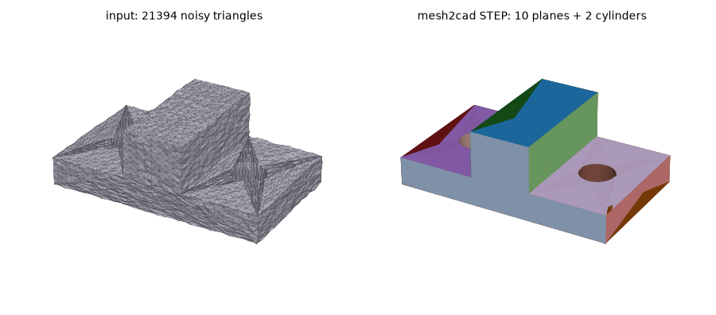
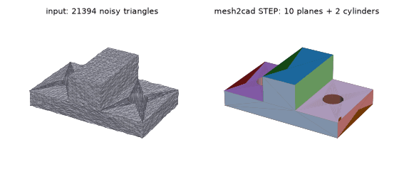

# mesh2cad

mesh2cad converts an STL mesh of a simple mechanical part into editable parametric CAD: STEP, CadQuery, OpenSCAD, and FreeCAD scripts. It is also an MCP server.

[](https://github.com/emirmrkaljevic/mesh2cad/actions/workflows/ci.yml)
[](https://pypi.org/project/mesh2cad/)
[](https://glama.ai/mcp/servers/emirmrkaljevic/mesh2cad)

OBJ and PLY meshes work the same way. The fit runs on your machine. Nothing is uploaded.

A STEP file is the solid. When the fit is exact, a hole is one cylindrical face, not a ring of triangles. A script is for changing a dimension and rebuilding. CadQuery is Python. OpenSCAD is the text the Customizer on Thingiverse and Printables edits. The FreeCAD file is a macro. All three use the same names, so `hole_1_d` is the same hole in each of them.



*Left: a 21k-triangle mesh with 0.1 mm noise. Right: the STEP file mesh2cad writes, 10 planes and 2 cylinders, max deviation 0.05 mm from the true part.*



Four printer parts, with the STEP files and the generated scripts, are in the [example gallery](https://huggingface.co/spaces/mesh2cad/mesh2cad).

## Install

```
pip install mesh2cad
```

Python 3.10 or newer. That install is the command line tool and STEP export. OpenCascade comes in with the package (`cadquery-ocp`).

`pip install "mesh2cad[mcp]"` adds the server. `pip install "mesh2cad[cadquery]"` lets mesh2cad run a generated `.py` and check it before the file is written. OpenSCAD and FreeCAD are separate programs, not pip packages. Without `openscad` on `PATH`, a `.scad` file is still written and the command says it was not verified. A `.FCMacro` is written only when a check passes. What happens when `freecadcmd` is missing is in [Install](docs/install.md).

## Quick start

```
mesh2cad convert bracket.stl --cadquery bracket.py
mesh2cad edit bracket.py --set hole_1_d=8 --in-place -o bracket.step
```

The first command writes `bracket.py`. Diameters, thicknesses, and positions are names at the top of the file. The second sets `hole_1_d` to 8 mm, rewrites the script, and writes `bracket.step`. Every other byte of the file stays as it was.

`mesh2cad edit bracket.py --set base_x=+2` adds 2 mm to the current length. A leading `+` or `-` is a change from the current number, not how you set a negative value. `mesh2cad params bracket.py` prints each name, its value, and the unit when there is one.

A STEP file on its own is `mesh2cad convert part.stl -o part.step`. Add `--report report.md` for the numbers: Hausdorff and RMS deviation, volume error, face types, and the method (`exact`, `faceted-hybrid`, or `faceted`). Open that STEP file in FreeCAD, Fusion, Onshape, or another CAD tool and select a face.

If the part is outside what a script can express, or the rebuilt solid misses the check, the script is not written and the command exits with code 2. The reason is printed. The same convert can write `.scad` and `.FCMacro`. Flags are in the [CLI reference](docs/cli.md). What the scripts contain is in [CadQuery](docs/cadquery.md), [OpenSCAD](docs/openscad.md), and [FreeCAD](docs/freecad.md). The edit rules are in [Parameters](docs/parameters.md).

## What it handles

It is meant for simple mechanical parts: plates, brackets, and boxes with holes, slots, bosses, and fillets. It fits planes, cylinders, spheres, cones, and constant-radius rounds, and writes those as faces you can select.

It does not recover organic or sculpted shapes, scans, or free-form surfaces. When a fit is poor it does not invent a surface. STEP output falls back to a faceted solid that is still valid, and the report names that fallback. A script is held to a tighter check: deviation at most max(4 times the tolerance, 0.1 mm), and volume error at most 1%. Miss that, and the script is refused.

Six Original Prusa i3 MK3S printed parts in the test set come back as exact STEP, and all six also as a script. The measurements, including the small belt-profile patches that stay faceted, are in [Real parts](docs/real-parts.md). Synthetic noise tests are in [Benchmarks](docs/benchmarks.md). The fitted-surface list, the parameter names, and the refusals are in [Limits](docs/limits.md) (v0.27.0). The pipeline is in [How it works](docs/how-it-works.md).

## MCP

```
pip install "mesh2cad[mcp]"
mesh2cad mcp
```

That starts the server on stdio. Point a client at it like this:

```json
{ "mcpServers": { "mesh2cad": { "command": "mesh2cad", "args": ["mcp"] } } }
```

The tools are `convert`, `analyze`, `report`, `to_cadquery`, `to_openscad`, `to_freecad`, `list_params`, and `edit_params`. Arguments, return values, and the directory listings are in [MCP](docs/mcp.md).

## Docs

[Install](docs/install.md) is the extras and the OpenSCAD and FreeCAD programs. [CLI](docs/cli.md) is every command. [CadQuery](docs/cadquery.md), [OpenSCAD](docs/openscad.md), and [FreeCAD](docs/freecad.md) are the parameter lists and the checks. [Parameters](docs/parameters.md) is `params` and `edit`. [MCP](docs/mcp.md) is the tool reference. [How it works](docs/how-it-works.md), [Limits](docs/limits.md), [Benchmarks](docs/benchmarks.md), and [Real parts](docs/real-parts.md) are the fit, the refusals, and the numbers. [Development](docs/development.md) is how to run the tests. The [changelog](CHANGELOG.md) is the version history.

Shorter pages on the project site: [overview](docs/index.html), [STL to STEP](docs/stl-to-step.html), [STL to OpenSCAD and CadQuery](docs/stl-to-openscad.html), and [FAQ](docs/faq.html).

A mesh that converts badly can go in a [GitHub issue](https://github.com/emirmrkaljevic/mesh2cad/issues/new/choose). There is a template for an STL that fails.

## License

MIT. See [LICENSE](LICENSE).

<!-- mcp-name: io.github.emirmrkaljevic/mesh2cad -->
