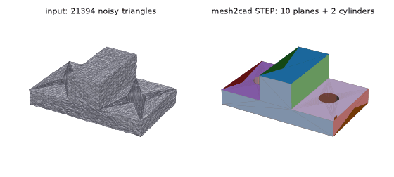
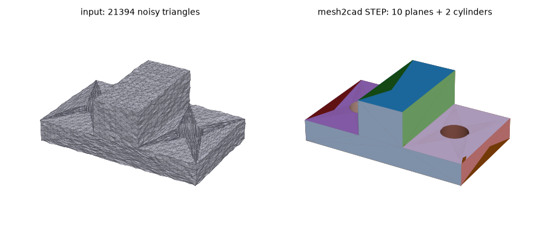

# mesh2cad
[](https://github.com/emirmrkaljevic/mesh2cad/actions/workflows/ci.yml)

Turn 3D meshes (STL/OBJ/PLY) into **real, editable CAD (STEP)** — fitted planes and cylinders instead of triangle soup. CLI + MCP server for AI agents. MIT, pure Python on top of OpenCascade.





*Left: 21k-triangle mesh with 0.1 mm noise. Right: the STEP mesh2cad writes — 10 planes + 2 cylinders, max deviation 0.05 mm from the true part.*

## Install
```
pip install "mesh2cad[mcp] @ git+https://github.com/emirmrkaljevic/mesh2cad"
```
(PyPI release coming.)

## Use
```
mesh2cad convert part.stl -o part.step --tol 0.1 --report report.md
mesh2cad report part.stl --json
```
`--tol` ≈ the noise / accuracy of your mesh in model units (default 0.1 % of the bounding-box diagonal).

Output: STEP + fidelity report — method (`exact` / `faceted-hybrid` / `faceted`), face types, solid validity, two-sided Hausdorff / RMS deviation, volume error, % area per surface type.

### MCP server (Claude Desktop, Cursor, …)
```json
{ "mcpServers": { "mesh2cad": { "command": "mesh2cad", "args": ["mcp"] } } }
```
Tools: `convert(input_path, output_path?, tol?, cylinders?)`, `analyze(input_path, tol?)`, `report(input_path, tol?)`.

## How it works
1. Load + clean mesh (trimesh); Taubin-smoothed copy for normals.
2. Region growing into planes; strip chains and leftovers are fitted as cylinders (robust nonlinear refinement); split/redundant regions are merged and absorbed.
3. Exact B-rep (OCP / OpenCascade): plane polygons from triple-plane intersections, circles from plane ∩ cylinder, cylindrical faces, sewn into a solid and validated.
4. Fallbacks: hybrid faceted solid (vertices snapped to fitted surfaces, coplanar triangles merged), then raw faceted solid.
5. Fidelity report against the input mesh.

## Self-test benchmark
Ground-truth cadquery parts → tessellated + subdivided (≤ 2 mm edges) → Gaussian vertex noise → mesh2cad → compared with the truth. 3 seeds, worst case shown (`python benchmarks/run.py`); the same cases run in CI.

| part | noise σ (mm) | exact | faces (plane/cyl) | Hausdorff (mm) | RMS (mm) | vol err % | time s |
|---|---|---|---|---|---|---|---|
| cube | 0.0 | 3/3 | 6/0 | 0.000 | 0.000 | 0.00 | 0.9 |
| cube | 0.05 | 3/3 | 6/0 | 0.019 | 0.006 | 0.07 | 0.8 |
| cube | 0.2 | 3/3 | 6/0 | 0.075 | 0.026 | 0.34 | 0.9 |
| l_bracket | 0.0 | 3/3 | 8/0 | 0.000 | 0.000 | 0.00 | 1.3 |
| l_bracket | 0.05 | 3/3 | 8/0 | 0.040 | 0.006 | 0.03 | 1.2 |
| l_bracket | 0.2 | 3/3 | 8/0 | 0.216 | 0.026 | 0.15 | 1.2 |
| stepped_block | 0.0 | 3/3 | 11/0 | 0.000 | 0.000 | 0.00 | 1.2 |
| stepped_block | 0.05 | 3/3 | 11/0 | 0.032 | 0.006 | 0.02 | 1.6 |
| stepped_block | 0.2 | 3/3 | 11/0 | 0.136 | 0.022 | 0.07 | 1.6 |
| plate_with_hole | 0.0 | 3/3 | 6/1 | 0.015 | 0.002 | 0.00 | 2.4 |
| plate_with_hole | 0.05 | 3/3 | 6/1 | 0.028 | 0.006 | 0.05 | 2.3 |
| plate_with_hole | 0.2 | 3/3 | 6/1 | 0.078 | 0.023 | 0.18 | 2.7 |
| boss | 0.0 | 3/3 | 7/1 | 0.027 | 0.006 | 0.01 | 2.1 |
| boss | 0.05 | 3/3 | 7/1 | 0.031 | 0.007 | 0.04 | 2.7 |
| boss | 0.2 | 3/3 | 7/1 | 0.090 | 0.016 | 0.07 | 2.5 |
| ribbed_plate | 0.0 | 3/3 | 10/2 | 0.013 | 0.002 | 0.00 | 2.9 |
| ribbed_plate | 0.05 | 3/3 | 10/2 | 0.028 | 0.005 | 0.03 | 3.1 |
| ribbed_plate | 0.2 | 3/3 | 10/2 | 0.108 | 0.020 | 0.12 | 3.3 |

"exact" = valid B-rep with the true face count.

## Limits (v0.1)
Planes + cylinders only (no cones, spheres, fillets/free-form yet); cylinders must end on planes perpendicular to their axis (through-holes, bosses, pins). Anything else falls back to a faceted solid — still a valid STEP, just not clean faces.

## Development
```
pip install -e .[dev]
pytest
python docs/make_demo.py   # regenerate images (needs matplotlib, pillow)
```

License: MIT
